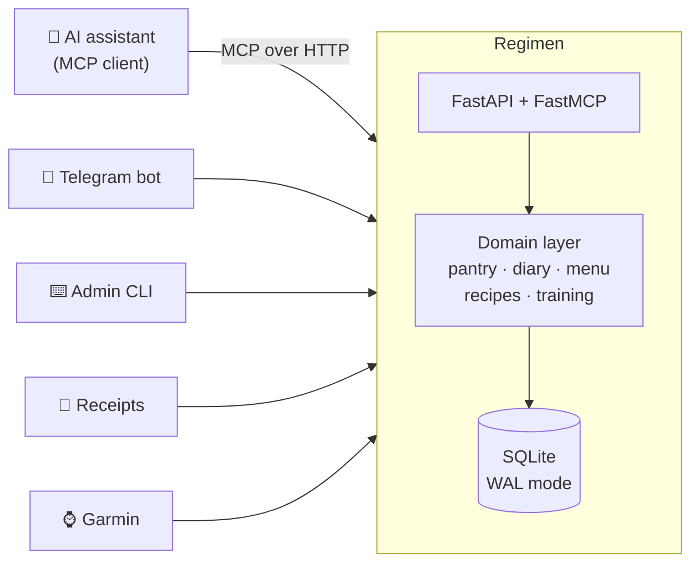

<div align="center">

# Regimen

*the routine you actually keep — food, training, and the shelf behind both*

**A self-hosted memory for your kitchen and your training — and an MCP server that lets an AI assistant read it.**

Your pantry, your food diary, your recipes and your gym history live in one small database you own.
Claude, or any MCP-capable assistant, plugs into it and finally answers the question a chatbot never could:
*what do I actually have in the fridge right now, and what should I eat first?*

[](https://www.python.org/)
[](https://fastapi.tiangolo.com/)
[](https://modelcontextprotocol.io/)
[](https://www.sqlite.org/wal.html)
[](https://docs.astral.sh/ruff/)
[](LICENSE)
[](#your-data-stays-yours)

</div>

---

## Why this exists

Ask any AI assistant for a dinner plan and it will happily invent one. It does not know that
the tub of cottage cheese you opened on Tuesday expires today, that you already ate meatballs
for lunch, or that the chicken lost 70 grams when you trimmed the skin off. So it recommends
food you do not have, forgets the food you do, and the open packet quietly goes bad.

A language model has no memory of your fridge. **This project is that memory.**

It is a small service you run yourself. It tracks what you bought, what you cooked, what you
ate and what you lifted — and exposes all of it over the [Model Context Protocol](https://modelcontextprotocol.io/),
so your assistant stops guessing and starts answering from facts.

## What you get

| | |
|---|---|
| 🥫 **Pantry that actually adds up** | Batches, storage places, expiry dates. A balance is the sum of its movements, not a number someone overwrites — eating 150 g out of a 350 g pack leaves 200 g, not an empty slot. |
| 📓 **A food diary that writes itself** | Log a meal and the ingredients leave the pantry automatically. Eating out touches nothing. Macros are stored as a snapshot, so editing a product card never rewrites your history. |
| 🍽️ **Menus built from what is in the fridge** | Whatever expires first goes in first. The same protein never lands two days running. Every plate gets protein, vegetables and fat — and if you fall short of your targets, you are told the number instead of being handed a rounded-up story. |
| 📖 **A recipe book that knows your kitchen** | Your own recipes, with the unknowns written down instead of papered over. Search answers "what can I cook right now" against the actual shelf. |
| 🏋️ **Training that plans itself** | Your weekly program, every set you logged, and next week's weights computed from them by rule — the top of the rep range in every working set, twice running, then 2-10 % ([ACSM, 2009](https://journals.lww.com/acsm-msse/fulltext/2009/03000/progression_models_in_resistance_training_for.26.aspx)). Written into the watch nightly with warm-up, per-set comments and the reason behind each number. No model involved: it is arithmetic you can read. |
| 🧾 **Receipts into stock** | Grocery receipts (Silpo integration included) become pantry batches. Non-food is filtered out. An unrecognised line is never guessed — it waits for you, and your answer is remembered forever. |
| ⌚ **Garmin, honestly** | Sleep, HRV, workouts — always served with their freshness. "Last sync was 4 days ago" is more useful than yesterday's numbers dressed up as today's. |
| 🔌 **MCP tools** | Everything above is available to your assistant as typed tools, with the guardrails baked in. |

## How it fits together



One database. One domain layer. Three ways in — an assistant, a chat, a terminal. Nothing is
duplicated between them, so a fact entered anywhere is a fact everywhere.

## The MCP tools

Point any MCP client at the server and these appear. Read tools answer questions; write tools
record facts; state-changing tools ask a human first.

**Pantry**

| Tool | What it does |
|---|---|
| `pantry_list` | What is in the house: grams remaining, storage place, expiry |
| `pantry_expiring` | What is about to go bad — the first input to any menu |
| `pantry_correct` | You weighed it; the balance becomes your number |
| `pantry_waste` | You threw it out; recorded as fact |
| `pantry_consume_draft` | Proposes a write-off. The assistant can never perform one itself |

**Diary**

| Tool | What it does |
|---|---|
| `diary_log_meal` | Records what you ate; pantry movements follow automatically |
| `diary_adjust_meal` | "It was 370 g, not 350" — stock corrects itself |
| `diary_today` / `diary_totals` | The day's totals with the composition behind them |

**Menu & recipes**

| Tool | What it does |
|---|---|
| `menu_propose` | A day's menu from what is actually home. Plans nothing into the pantry |
| `menu_swap` | You refused a dish — rebuild without it |
| `recipe_find` / `recipe_get` | Search against the shelf; full method, yield and stated unknowns |
| `recipe_add` / `recipe_set_base` | Write a recipe down; fix the product it was matched to |

**Training**

| Tool | What it does |
|---|---|
| `gym_today` | Today's session, stamped with how fresh the snapshot is |
| `exercise_history` | What weight you actually used last time |
| `exercise_how` / `gym_equipment` | How to perform it, and what your gym has for it |
| `gym_log_set` | Records a set — a fact, so it is written immediately |
| `workout_next_week` | Next week's version of a session, computed from what you lifted, with the reason for each number |
| `workout_push_to_garmin` | Writes a proposed session into the Garmin calendar — only after you say yes |

**Shopping, wearables, rules**

| Tool | What it does |
|---|---|
| `shop_deficit` | What is missing to hit your targets |
| `garmin_freshness` / `garmin_recent` | Wearable data, always with its age attached |
| `receipt_line_resolve` | Teaches the system a receipt line, permanently |
| `reminders_list` / `reminder_acknowledge` / `reminder_snooze` | Supplements and reminders |
| `rules_current` | The behaviour rules the assistant must follow |

## Guardrails

The assistant is a guest in your data, and the boundaries are enforced by the server, not by a
polite prompt:

- **It cannot change your world on its own.** Writing off food, throwing it out, ordering
  groceries, changing your nutrition targets — none of it happens on the assistant's
  initiative. It shows you what it wants to do and waits for your word. The guarantee is in
  the access model, not in a prompt: those tools demand a write-scoped token, so a read-only
  client physically cannot spend your pantry.
- **Recording a fact is not a decision.** You ate; you lifted; you weighed the pack. Those are
  logged immediately, because making the truth easy to enter is the whole point.
- **It is not allowed to invent numbers.** Missing data is reported as missing. A day's totals
  come with a flag when something in them is unknown, because a total that silently omits
  a meal is a lie with a confident face.
- **No medical data.** Not stored, not synced, not guessed at.

## Your data stays yours

There is no cloud account and no vendor in the middle. One SQLite file on a machine you
control, backed up with the Online Backup API, optionally copied off-box by a command you
choose. The repository holds code — never your pantry, your diary, your weight or your receipts.

SQLite is a deliberate choice, not a shortcut: one user, tens of writes a day, and the price of
PostgreSQL would be another container, another backup path and another thing to wake up for.
The conditions that make it correct — local volume, short transactions, a single writer, WAL —
are documented in `app/db.py` and tested.

## Quick start — your own server

Everything that works for one person here works for you after about half an hour of setup:
Garmin sync, morning/evening/weekly reports in Telegram, a chat bot over your data, and
next week's strength training written into your watch every night.

```sh
git clone <this repository> regimen && cd regimen
cp env.example .env && nano .env              # timezone and the rest — read the comments
sh scripts/set-secrets.sh                     # Telegram token, chat id, Anthropic key
docker compose up -d --build
docker compose exec app python -m app.cli init
docker compose exec app python -m app.cli client-add \
    --name telegram --kind telegram --telegram-chat-id <your chat id>
docker compose exec app python -m app.cli garmin-login     # email, password, 2FA — once
cp -r examples/training my-training && nano my-training/*     # your own programme
docker compose cp my-training app:/tmp/my-training
docker compose exec app python -m app.cli import-training --dir /tmp/my-training
docker compose exec app python -m app.cli gym-plan --dry-run   # what tonight would write
```

The full walkthrough — targets, the training programme format, backups, HTTPS, connecting
Claude — is in **[`docs/deployment.md`](docs/deployment.md)**. Import your own programme,
not the sample: a day already imported is kept, not replaced.

> **Language.** The assistant, the reports and the workout comments on the watch are in
> Russian. Code, docs and identifiers are in English.

## Developing locally

```sh
python -m venv .venv && .venv/bin/pip install -e ".[dev]"
cp env.example .env
.venv/bin/python -m alembic upgrade head   # create the database
.venv/bin/python -m app.cli init           # create the owner
.venv/bin/pytest -q                        # the test suite, all green
.venv/bin/uvicorn app.main:app --port 8090
```

Rules are versioned: changing a target later never overwrites the old one, so "why was
the target different in spring" stays answerable.

The token from `client-add --kind claude` goes in a header, which is all a terminal client
needs. A phone cannot do that — the connector screens in Claude and ChatGPT offer OAuth or
nothing — so the service is also its own authorisation server, and the owner approves each
connection with one tap in Telegram: [`docs/connecting.md`](docs/connecting.md).

Day-to-day operation, backups and restore drills: [`docs/operations.md`](docs/operations.md).
How the nightly plan decides: [`docs/training-plan.md`](docs/training-plan.md).

## Command line

```sh
python -m app.cli targets --protein 130-150   # set your macro targets
python -m app.cli policy-set --kind carb_days --json '{...}'
python -m app.cli status                 # what the service knows right now
python -m app.cli backup                 # snapshot, verified after writing
python -m app.cli verify                 # check an existing snapshot
python -m app.cli restore <file>         # restore from one
python -m app.cli client-add/list/revoke # manage MCP access tokens
python -m app.cli silpo-sync             # pull receipts
python -m app.cli garmin-login           # one-time Garmin login (2FA)
python -m app.cli garmin-sync            # pull wearable data
python -m app.cli import-training --dir <dir>  # load a training programme
python -m app.cli gym-plan --dry-run     # what tonight's plan would write
```

## Layout

```
app/
  api/          FastAPI routes and dependencies
  mcp/          the MCP server — every tool above
  domain/       pantry, diary, menu, recipes, training, rules
  models/       SQLAlchemy models
  integrations/ Silpo receipts, Garmin
  bot/          Telegram
  workers/      scheduled syncs, reports, the nightly plan, backups
  core/         access scopes, jobs, backups, security
alembic/        migrations
tests/          the test suite
examples/       a sample training programme and rule files
docs/           operations, deployment
```

## Principles

A few rules shaped most of the code, and they are worth knowing before you extend it:

1. **The system knows only what was entered** — so entering a fact must be easier than not entering it.
2. **Never invent a number.** "Unknown" is a valid answer; a plausible average is not.
3. **A balance is a sum of movements.** Corrections are new movements, never edits to history.
4. **Snapshots, not references.** Editing a product card must not rewrite what you ate last month.
5. **The human owns every state change.** The assistant proposes; you decide.

## Contributing

Issues and pull requests are welcome. Run `pytest -q` and `ruff check app tests scripts` before opening
one; CI runs both on Python 3.12 and 3.13.

## License

[MIT](LICENSE) — use it, change it, run it, ship it.
